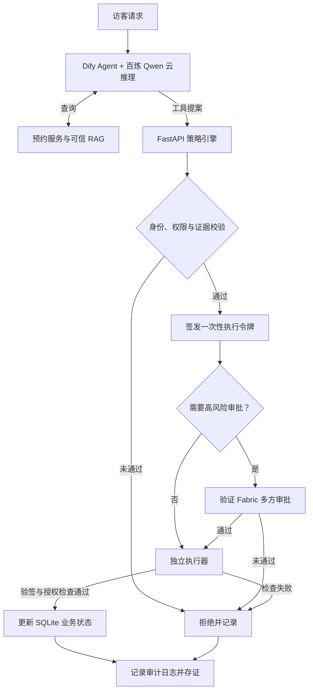

# 基于密码学与联盟链的边缘大模型 Agent 可信工具调用与审计系统

本项目以**校园虚拟通行权限管理**为实验场景，研究当边缘部署的大模型 Agent 受到提示词注入、知识库投毒或工具调用诱导时，确定性策略、密码学授权和联盟链审批能否阻止未经授权的状态变更。系统使用模拟访客、预约和权限数据，所有操作都在虚拟环境中执行。

**项目状态**　E 的 Dify 基础 Agent 已完成云模型与只读预约工具联调。A–D 的业务执行、安全防护和对照实验处于开发阶段。

## 基础 Agent 快速开始

1. 下载 [Dify 应用包](agent/dify/edge-agent-dify-smoke.ifpkg)，在 Dify Studio 选择 **Create → Import App**。应用包包含 Agent 和只读预约 Mock。
2. 在 Dify 的 **Integrations → Model Provider** 为 **OpenAI-API-compatible** 配置新加坡百炼 API Key，模型填 `qwen3.5-flash-2026-02-23`，工具调用类型选 **Tool Call**。参见 [配置与联调说明](agent/dify/README.md)。
3. 打开 Agent 的 **Debug & Preview**，输入「请帮我查一下预约 BK-1042 的状态和到访地点」。展开 **Used query_booking**，核对调用参数 `booking_id=BK-1042`，以及工具返回和最终答复中的 `demo-7H2Q`。

已通过的实测包括中文对话、结构化工具调用、工具结果回传和缺少预约编号时追问。当前验证使用云端推理和合成预约数据，安全实验将接入模拟业务写操作和独立执行器。

## 研究问题

1. 当 Agent 已经提出格式正确的越权工具调用时，确定性策略能否在执行业务操作前拦截？
2. 在强基线已有策略校验、一次性签名令牌和防重放机制的情况下，绑定可信业务证据还能拦截哪些操作？
3. 相对于采用相同审批规则的本地方案，Fabric 多方审批与审计存证分别带来哪些可验证能力？
4. 各机制对正常任务完成率、攻击成功率和处理延迟有何影响？

## 系统架构

上图为完整方案的写操作路径。读取类工具也按策略检查访问范围。实验中的 B0 使用隔离的模拟业务工具直接执行，其他配置逐层增加相应防护。

| 层级 | 计划采用的技术 | 职责 |
| --- | --- | --- |
| Agent | Dify Cloud、百炼新加坡 `qwen3.5-flash-2026-02-23`、Function Calling | 理解中文请求，根据工具 Schema 提出操作。当前只读预约 Mock 已完成实测 |
| 业务与执行 | FastAPI、OpenAPI、SQLite | 提供访客、预约、权限和会话服务。独立执行器验证授权后更新状态 |
| 可信知识 | BGE-M3、Chroma、SHA-256、Ed25519 | 检索校园规章，校验文档与片段来源、内容摘要和发布版本 |
| 策略与授权 | FastAPI、Ed25519 | 裁决工具与参数范围，验证身份和业务证据，签发一次性执行令牌 |
| 审批与审计 | Hyperledger Fabric、Fabric Gateway、Merkle 根 | 记录高风险操作的多方审批，登记发布摘要并存证日志批次 |

**拟接入工具**

| 用途 | 工具 |
| --- | --- |
| 查询预约和权限状态 | `query_booking`、`get_access_status` |
| 登记访客与管理虚拟权限 | `register_visitor`、`grant_access`、`grant_restricted_access`、`revoke_access` |
| 控制模拟报警状态 | `disable_alarm` |

### 一次受限区域授权

1. Dify 根据访客请求提出 `grant_restricted_access`，提交访客、目标区域和有效期。策略服务从可信会话获取调用者身份，并通过预约服务核对预约状态、归属、区域和时间范围。RAG 提供可追溯的规章片段，权限判断由确定性规则完成。
2. 策略通过后签发 Ed25519 一次性令牌。令牌限制具体工具、规范化后的参数、有效期和唯一标识。启用证据绑定时，令牌还关联执行会话、已核验证据及策略版本。执行时需要按该配置核验这些关联和证据状态。
3. 对需多方审批的操作，执行路径按操作摘要查询并验证对应审批，检查审批身份、人数、有效性及参数一致性。执行器完成检查后更新 SQLite，并在同一业务事务内完成令牌消费与状态变更，防止并发重放。
4. 审计记录关联请求、策略裁决、审批引用和执行结果。启用链上存证时，审计方可根据链上 Merkle 根核验已存证日志批次。业务数据和日志正文保存在链下。

## Baseline 与消融

| 配置 | 名称 | 计划启用的机制 |
| --- | --- | --- |
| B0 | Agent-Only | Agent 直接调用隔离的模拟业务工具 |
| B1 | Policy-Guard | 确定性策略与本地审批 |
| **B2** | **Token-Guard（主基线）** | B1 加一次性签名令牌，绑定工具与参数，校验有效期并防重放 |
| B2 + Evidence | 证据绑定消融 | B2 加业务证据与授权上下文绑定，以及执行时核验，沿用本地审批 |
| B2 + Chain | 联盟链消融 | B2 加 Fabric 审批验证与审计存证 |
| **Ours** | **Evidence-Bound Guard** | B2 加证据绑定、执行时核验、Fabric 审批验证与审计存证 |

同一轮对照实验固定模型快照、提示词、推理参数、工具 Schema、正常任务、攻击输入和基础业务规则。B1、B2 与 B2 + Evidence 的高风险操作使用本地审批。对应链上配置沿用相同的业务审批门槛，并验证审批出处、操作摘要及链上记录。

- **B0 → B1** 评估确定性策略对工具越权的拦截效果。
- **B1 → B2** 评估一次性令牌对伪造、参数篡改与重放的防护。
- **B2 → B2 + Evidence** 评估证据绑定的增量。重点测试签发后撤销预约、执行会话错配或策略版本变化，按实际校验行为归因。
- **B2 → B2 + Chain** 分别测试审批验证和已存证日志的篡改检测，测量相对本地审批的开销。
- **两组单模块消融 → Ours** 检查组合后各机制的效果与端到端开销。

### 实验与验收

| 实验 | 主责 | 协作 |
| --- | --- | --- |
| 基础 Agent 部署、中文对话和工具调用冒烟测试 | E | A |
| 正常业务任务、直接提示词注入、B0 对比 | A | D、E |
| 间接提示词注入、令牌伪造、参数篡改、重放、跨会话、证据绑定消融 | D | A、C |
| RAG 投毒、假冒文档或片段来源、配置篡改、发布回滚 | C | A、D、E |
| 非法审批身份、单方越权、摘要不匹配、审计日志篡改 | B | D |
| 全配置统一运行、端到端性能、结果汇总 | A | B、C、D |
| 实验结果可视化与汇报 | E | A、B、C、D |

攻击实验分别记录 **Agent 是否提出越权调用**以及 **未经授权的业务状态变更是否发生**。以状态变更作为执行层攻击成功的判据，并记录失败发生的阶段和错误码。正常任务统计完成率、工具调用成功率和合法请求误拒绝率。延迟分别汇报端到端耗时及策略、令牌、审批和审计的开销。有人工等待的任务单独记录等待耗时。

## 五人分工

| 角色 | 开发任务与交付物 | 论文调研方向 |
| --- | --- | --- |
| **A · 业务系统与端到端集成** | 实现 FastAPI 业务服务、预约校验、SQLite、业务工具和 OpenAPI。接入 E 的 Agent、C 的可信 RAG、D 的策略与令牌验证、B 的审批与审计服务。交付独立执行器、端到端演示及统一实验结果 | Agent 工具调用、业务执行可靠性、安全工具接口 |
| **B · 联盟链与多方审批** | 部署 Fabric 测试网络和组织证书，交付审批链码、Gateway、审批及撤销验证接口、配置与知识发布摘要登记、日志 Merkle 根存证及专项实验 | 许可链、分布式授权、智能合约、可验证审计 |
| **C · 密码学与可信知识** | 交付 SHA-256 / Ed25519 公共组件、提示词、工具配置和知识库签名发布及版本核验。以 BGE-M3 和 Chroma 实现带来源校验的校园规章检索，并完成投毒、篡改和回滚实验 | 软件供应链安全、模型完整性、可信 RAG、溯源 |
| **D · 安全策略与可信执行** | 定义信任边界、工具白名单与风险规则，实现 B1、B2 和证据绑定机制。交付签发与验签、防重放、审批接入、执行器验证库和专项消融实验 | 提示词注入防御、能力授权、Agent 工具隔离 |
| **E · 基础 Agent 与汇报** | 配置 Dify 和百炼云模型、系统提示词及推理参数，用 Mock 工具验证调用 Schema。交付基础 Agent、B0 初始配置、Dify 应用包、复现说明和冒烟记录。汇总 A–D 的方法和结果，负责 PPT、讲稿、演示材料及汇报 | 汇总 A–D 的论文依据及其与实施模块的对应关系 |

百炼托管模型权重。权重篡改与回滚实验需要另行部署可访问权重的本地模型。

A–D 各自承担本模块攻防实验。A 负责业务工具和端到端集成，E 负责基础 Agent 部署及汇报。各成员为自己的模块自主挑选有可靠出处和可复现依据的论文，在对应 Issue 或 PR 记录出处、采用的方法、实现位置及验证方式。

## 接口交接

| 提供方 | 接口或输出 | 接收方 |
| --- | --- | --- |
| E | Dify 与百炼接入说明、基础 Agent 应用包、模型版本和冒烟记录 | A、C |
| A | 预约校验服务、虚拟业务工具 OpenAPI、权限数据库和执行器 | D、E |
| C | 可信检索、签名公共库、发布版本核验 | A、D |
| D | 策略裁决、令牌签发、验签与执行审计接口 | A |
| B | 链上审批查询、验证与撤销，发布摘要登记和日志存证 | C、D |
| A–D | 技术方案、可复现实验记录、结果与结论 | E |

跨模块接口提交 Schema、请求和响应示例、错误码以及单元测试。A、B、C、D 联调时统一身份与会话来源、操作参数规范化和摘要算法、证据标识与版本，以及审批撤销的处理方式。E 记录模型标识、推理参数和 Dify 应用包版本，A 汇总工具、策略和实验配置版本。

## 如何参与

1. 在 [Issues](https://github.com/Gump111458785/edge-agent-trust/issues) 领取或创建与 A–E 分工对应的任务，注明交付物、接口依赖和验收方式。
2. 从 `main` 创建工作分支。可按模块命名，例如 `feat/a-booking-api` 或 `feat/d-token-guard`。外部贡献者可以从 Fork 提交。
3. 向 `main` 提交 Pull Request，关联 Issue，说明改动范围和复现步骤，并附对应测试或实验记录。涉及接口变更时，请上下游模块成员共同审阅。

E 已完成 Mock 工具冒烟测试。下一步接入 A 的业务 API 和 B0，然后联通 D 的 B1/B2。B 和 C 可依接口并行开发，最后接入完整方案并运行统一对照。复现材料使用模拟数据、示例配置和可重新生成的测试身份。仓库提交仅包含可公开内容。

## 最终交付

- **系统**：基础 Agent、虚拟通行业务与独立执行器、可信 RAG、项目配置与知识完整性核验、策略和两种令牌配置、Fabric 审批与审计。
- **实验**：正常任务集、攻击集、模块测试、端到端对照及消融记录、安全性与性能分析。
- **汇报**：架构与流程图、论文方法与模块对应说明、实验图表、演示材料及讲稿。

## 许可证

本仓库采用 [MIT License](LICENSE)。
