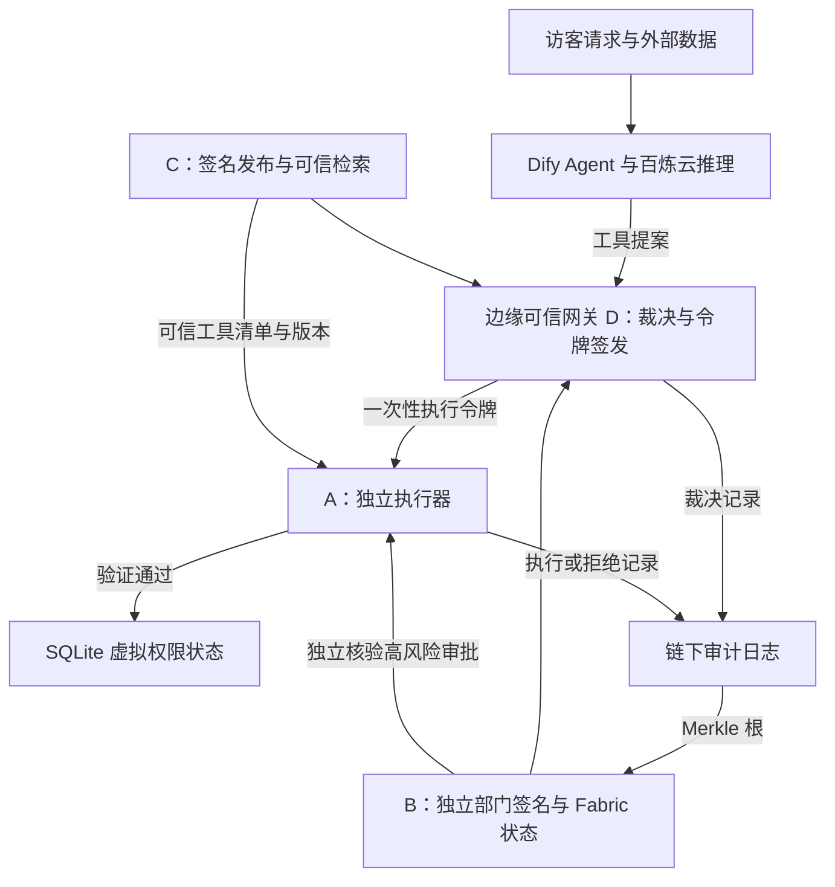

# 基于密码学与联盟链的边缘大模型 Agent 可信防护系统

本项目研究**面向不可信 Agent 的可验证工具执行授权机制**。以校园虚拟通行为实验场景，假设攻击者能影响 Agent 的输入、知识或配置，甚至控制它提出的工具调用。我们在边缘网关和独立执行器上验证来源、身份、参数、一次性授权及必要的多方审批，检验攻击在何种信任假设下能被挡在业务状态更新之前。

**项目状态**　E 已用 Dify 和新加坡百炼跑通无攻击、未接入项目防护的只读预约演示。A 的本地 SQLite 业务 API、独立执行器和状态评测已可运行。已用测试签发器与审批替身验证常规执行和拦截用例。Dify 真库联调、真实 D/B/C 服务接入与端到端攻防仍待完成。见 [A 的运行说明](business/README.md)及[接口契约](docs/a-interface-contract.md)。

## 基础 Agent 快速开始

1. 下载 [Dify 应用包](agent/dify/edge-agent-dify-smoke.ifpkg)，在 Dify Studio 选择 **Create → Import App**。应用包包含 Agent 和只读预约 Mock。
2. 在 Dify 的 **Integrations → Model Provider** 为 **OpenAI-API-compatible** 配置新加坡百炼 API Key，模型填 `qwen3.5-flash-2026-02-23`，工具调用类型选 **Tool Call**。参见 [配置与联调说明](agent/dify/README.md)。
3. 打开 Agent 的 **Debug & Preview**，输入「请帮我查一下预约 BK-1042 的状态和到访地点」。展开 **Used query_booking**，核对调用参数 `booking_id=BK-1042`，以及工具返回和最终答复中的 `demo-7H2Q`。

已通过的实测包括中文对话、结构化工具调用、工具结果回传和缺少预约编号时追问。当前验证使用云端推理和合成预约数据，安全实验将接入模拟业务写操作和独立执行器。

## 研究问题

1. 当 Agent 已提出越权调用，或攻击者绕过 Agent 直接请求执行器时，哪些操作可被确定性策略、一次性令牌及证据绑定分别拦住？
2. 当操作满足业务条件，但一个审批账号或单一授权服务被控制时，执行器能否独立验证来自多个组织的审批以及当前授权状态？
3. 如何验证运行中的知识、工具和配置来自获准发布版本，并发现已锚定日志被篡改？各机制对正常任务完成率与执行延迟有多大影响？

## 系统架构

边缘可信网关部署在模拟楼宇入口的本地机器上。Agent 的业务工具指向网关，网关验证会话和工具清单、获取已核验的证据、裁决操作、签发令牌并记录审计事件。A 的执行器独立验证授权，持有更新权限库所需的访问权限，并与 Agent 及签发进程隔离。读取工具同样经网关做访问范围检查。

访客文本、预约备注、检索片段和 Agent 输出作为数据处理。身份来自已认证会话，业务事实由网关直接向预约服务核对。高风险审批由各部门独立签名，Agent 和网关签发服务都不持有审批私钥。百炼只提供推理。使用云端模型时，完整性实验覆盖本项目管理的提示词、Agent 配置、工具清单、策略和知识库。权重完整性与权重回滚留给可访问模型文件的本地实验。

| 层级 | 计划采用的技术 | 职责 |
| --- | --- | --- |
| Agent | Dify Cloud、百炼新加坡 `qwen3.5-flash-2026-02-23`、Function Calling | 理解中文请求，根据工具 Schema 提出操作。当前只读预约 Mock 已完成实测 |
| 业务与执行 | FastAPI、OpenAPI、SQLite | 提供访客、预约、权限和会话服务。独立执行器验证授权后更新状态 |
| 可信发布与知识 | BGE-M3、Chroma、SHA-256、Ed25519 | 管理配置、规章和工具清单的签名发布、更新、撤销与使用时验证 |
| 网关与授权 | FastAPI、Ed25519 | 验证身份、会话、工具身份及证据，裁决参数范围并签发一次性令牌 |
| 多方审批与审计 | Hyperledger Fabric、Fabric Gateway、Merkle 根 | 维护按组织验证的审批与撤销状态，提供跨组织可核验的审计锚点 |

**拟接入工具**

| 用途 | 工具 |
| --- | --- |
| 查询预约和权限状态 | `query_booking`、`get_access_status` |
| 登记访客与管理虚拟权限 | `register_visitor`、`grant_access`、`grant_restricted_access`、`revoke_access` |
| 控制模拟报警状态 | `disable_alarm` |

### 一次机房授权如何执行

1. **核对业务条件。** 另建一条确实允许申请机房的模拟预约。D 从可信会话识别访客，从预约服务核实归属、目标区域和时段。C 签发的工具清单覆盖工具标识、描述、参数 Schema、风险级别、执行目标和服务身份。网关从已验证清单解析执行目标，校验请求参数和下游服务身份。D 为本次申请生成唯一操作 ID 和规范化操作摘要。
2. **收集独立审批。** 机房申请示例要求保卫处和信息中心各自授权。部门签名绑定本次操作 ID、目标和参数摘要及审批有效期。B 的链码检查应用层审批者身份、组织、有效期和审批规则，将有效审批与撤销写入 Fabric。Fabric 的 peer 背书另行约束哪些组织认可链码执行结果。
3. **签发并执行。** D 根据策略和审批状态签发短期 Ed25519 令牌，绑定工具、规范化参数摘要、受众、有效期和唯一令牌 ID。证据绑定版本再关联可信会话、预约证据标识与版本、工具清单及策略版本。A 独立验证签名、参数和适用证据，按可信风险规则判定是否需要审批。高风险执行通过与签发服务分离的验证路径检查已有效提交的审批、签名与组织门槛、操作摘要、撤销及状态新鲜度，验证失败则拒绝。SQLite 在同一事务内记录令牌消费、检查高风险操作 ID 未执行过并更新权限，覆盖并发重放及同一审批换新令牌的重用。
4. **记录和核验。** 日志关联提案、裁决、审批引用和执行结果。B 将日志批次的序号范围与 Merkle 根锚定到链上，审计方据此比对链下日志。已锚定批次的修改或删除可在审计时检测，未锚定尾部与失陷后生成的记录另行评估。

### 安全假设与适用边界

| 攻击者能力 | 需要验证的边界 |
| --- | --- |
| 控制 Agent 或直接请求执行端点 | 在执行器、信任根及数据库访问控制完好的条件下，缺少有效授权的写入被拒绝 |
| 篡改知识库、工具描述或策略文件，重放旧签名版本 | 比对内容摘要和可信版本状态。签名、发布授权及撤销由网关或执行器校验。合法签名文档中的恶意语句仍可能影响 Agent，继续用行动授权边界约束写入 |
| 取得一个审批账号，或单独取得 D 的签名密钥 | 前者无法凑齐两个组织的审批。后者可能签发常规动作令牌。只要 A 的独立验证、审批方门槛及配置根仍完好，高风险写入仍需针对本次操作的有效多方审批 |
| 完整网关或执行器失陷、满足门槛的审批方串通 | 分别记录可控组件和失效的假设。执行器与数据库写权限同时失陷时，应用层校验无法约束写入。审批方达到门槛后可共同批准操作 |

高风险实验须记录信任的 Fabric 节点或组织、状态新鲜度上限和撤销校验时点。状态无法确认、超过新鲜度上限或与已见状态发生回退时，执行器拒绝高风险操作。撤销若发生在验证之后、SQLite 提交之前，单独测量竞态窗口。Fabric 审批与审计各按其配置及故障假设评估。

## Baseline 与消融

| 配置 | 名称 | 计划启用的机制 |
| --- | --- | --- |
| B0 | Agent-Only | Agent 直接调用隔离的模拟业务工具 |
| B1 | Policy-Guard | 确定性策略与本地多方审批 |
| **B2** | **Token-Guard（主基线）** | B1 加一次性签名令牌，绑定工具与参数，校验有效期并防重放 |
| B2 + Evidence | 证据绑定消融 | B2 加业务证据与授权上下文绑定，以及执行时核验，沿用本地审批 |
| B2 + Chain | 联盟链消融 | B2 加 Fabric 审批验证与审计存证 |
| **Ours** | **Evidence-Bound Guard** | B2 加证据绑定、执行时核验、Fabric 审批验证与审计存证 |

同一轮对照实验固定模型快照、提示词、推理参数、工具 Schema、正常任务、攻击输入和基础业务规则。B1、B2 与 B2 + Evidence 的高风险操作使用本地审批。对应链上配置沿用相同的业务审批门槛，并验证审批出处、操作摘要及链上记录。

- **B0 → B1** 评估确定性策略对工具越权的拦截效果。
- **B1 → B2** 对比执行端的伪造、参数篡改与重放结果，同时记录现有服务访问控制已能阻止的请求。
- **B2 → B2 + Evidence** 评估证据绑定的增量。重点测试签发后撤销预约、执行会话错配或策略版本变化，按实际校验行为归因。
- **B2 → B2 + Chain** 固定策略、审批门槛和令牌机制，对比审批状态由单一服务保存与由 Fabric 共同维护时的行为。审批生效与日志审计分别测量。
- **两组单模块消融 → Ours** 检查组合后各机制的效果与端到端开销。

### 多方审批与联盟链的对照

选用**通过 D 业务策略的机房申请**。同一份操作提案和预约证据交给以下三种授权路径。先验证所有路径都能完成各自规则允许的正常授权，再注入同样的故障。

| 审批配置 | 验证条件 | 对比目的 |
| --- | --- | --- |
| 单方授权服务 | 单个服务给出批准结果 | 量化信任集中在单方时，一个审批账号或服务被控制的影响 |
| 本地多方签名（B2 家族的强对照） | 同样两个部门签名，绑定同一操作摘要，执行器独立验签并检查本地审批状态 | 测多方签名本身能拦住什么，保留有效期、撤销、参数绑定和防重放检查 |
| Fabric 多方授权（链上消融与 Ours） | 同样两个部门签名与验证规则，另核对有效提交的审批及其当前状态 | 测在中心审批存储可被篡改或回滚的条件下，独立组织维护的状态能提供什么增量 |

只控制一个审批账号、替换目标或重放已消费授权时，本地多签和链上多签都应拒绝。检验联盟链增量时，专门对中心审批状态进行回滚，例如恢复一份**签名仍有效但已被撤销**的审批，观察两组执行器是否能发现回退。如果两组都挡住，报告共同防护和实际开销。日志实验另外对比同一日志格式及 Merkle 批次在本地保存和跨组织锚定时的篡改可检出性。

### 实验与验收

| 实验 | 主责 | 协作 |
| --- | --- | --- |
| 基础 Agent 部署、中文对话和工具调用冒烟测试 | E | A |
| 正常业务任务、直接提示词注入、B0 对比 | A | D、E |
| 间接提示词注入、令牌伪造、参数篡改、重放、跨会话、证据绑定消融 | D | A、C |
| RAG 投毒、假冒文档或片段来源、配置篡改、发布回滚 | C | A、D、E |
| 单方审批失陷、多签缺失、摘要不匹配、撤销状态回滚、日志锚定 | B | A、D |
| 全配置统一运行、端到端性能、结果汇总 | A | B、C、D |
| 实验结果可视化与汇报 | E | A、B、C、D |

| 汇报演示 | 注入的故障或攻击 | 预期可观测结果 |
| --- | --- | --- |
| 知识与配置篡改 | 替换已签名规章、工具描述、执行器标识或策略，或重放旧版本。另提供一份合法签名但包含注入语句的文档 | 篡改在发布加载、检索或执行前校验时被拒绝。合法签名的注入文本进入输入后，独立记录模型提案与执行结果 |
| 被诱导的工具调用 | 诱导 Agent 提出越权写入，或绕过 Agent 向 A 发送无令牌、伪造、篡改、跨会话或已消费的请求 | 记录 D 的裁决与 A 的拒绝阶段，并用 SQLite 前后状态检查是否发生越权写入 |
| 伪造审批与日志篡改 | 对通过业务策略的机房申请尝试单方批准、替换摘要、回滚撤销状态或重放，另修改已锚定日志 | 独立观察业务执行结果和审计核验结果。对照本地多签与 Fabric，记录由哪一层发现问题 |

每个演示记录 **Agent 是否提出越权调用**、**未经授权的业务状态变更是否发生**、**在哪一层阻止或检测到**。直接请求执行器和事后日志篡改用例的 Agent 提案栏标为不适用。端到端测试观察模型真实行为，执行边界测试直接重放相同的结构化提案，确保模型未被诱导时也能验证后端。正常任务统计完成率、工具调用成功率和合法请求误拒绝率。端到端耗时与各验证环节分别计量，人工等待单列。

## 五人分工

| 角色 | 开发任务与交付物 | 论文调研方向 |
| --- | --- | --- |
| **A · 独立执行边界与端到端集成** | 实现 FastAPI、OpenAPI、预约服务和 SQLite。集成 D 的验签协议及 B 的独立审批验证，保证业务状态只能经执行器修改。测试绕过 Agent、无令牌直连、篡改及并发重放，汇总端到端结果 | Agent 工具调用、业务执行可靠性、安全工具接口 |
| **B · 联盟链与多方授权** | 实现独立组织身份、审批链码、有效提交与撤销状态验证，提供配置与知识发布摘要登记、日志 Merkle 锚定与核验。用单方和本地多签对照检验 Fabric 的增量 | 许可链、分布式授权、智能合约、可验证审计 |
| **C · 密码学与可信发布** | 交付 SHA-256 / Ed25519 公共组件，负责提示词、工具清单、策略与知识的签名发布、更新、撤销、防回滚和使用时校验。检索片段重新算摘要并核对已授权文档，测试投毒、冒充来源和合法签名的恶意内容 | 软件供应链安全、完整性、可信 RAG、溯源 |
| **D · 证据绑定与执行授权** | 在边缘网关核验可信身份、会话、证据、工具和参数，按风险签发短期一次性令牌，绑定规范化参数和适用证据。交付验证契约与消融实验，配合 A 验证错误提案无法取得执行能力 | 提示词注入防御、能力授权、Agent 工具隔离 |
| **E · 基础 Agent 与汇报** | 配置 Dify 和百炼云模型、系统提示词及推理参数，用 Mock 工具验证调用 Schema。交付基础 Agent、B0 初始配置、Dify 应用包、复现说明和冒烟记录。汇总 A–D 的方法和结果，负责 PPT、讲稿、演示材料及汇报 | 汇总 A–D 的论文依据及其与实施模块的对应关系 |

A–D 各自承担本模块攻防实验。A 负责业务工具和端到端集成，E 负责基础 Agent 部署及汇报。各成员为自己的模块自主挑选有可靠出处和可复现依据的论文，在对应 Issue 或 PR 记录出处、采用的方法、实现位置及验证方式。

## 接口交接

| 提供方 | 接口或输出 | 接收方 |
| --- | --- | --- |
| E | Dify 与百炼接入说明、基础 Agent 应用包、模型版本和冒烟记录 | A、C |
| A | 预约校验服务、虚拟业务工具 OpenAPI、权限数据库和执行器 | D、E |
| C | 可信检索、签名公共库、工具清单及发布版本核验 | A、D、E |
| D | 策略裁决、令牌签发、证据绑定及执行器验证契约 | A |
| B | 独立审批签名、有效提交与撤销状态验证，发布与日志锚定 | A、C、D |
| A–D | 技术方案、可复现实验记录、结果与结论 | E |

跨模块接口提交 Schema、请求和响应示例、错误码以及单元测试。A、B、C、D 联调时统一身份与会话来源、操作参数规范化和摘要算法、证据标识与版本，以及审批撤销的处理方式。E 记录模型标识、推理参数和 Dify 应用包版本，A 汇总工具、策略和实验配置版本。

## 如何参与

1. 在 [Issues](https://github.com/Gump111458785/edge-agent-trust/issues) 领取或创建与 A–E 分工对应的任务，注明交付物、接口依赖和验收方式。
2. 从 `main` 创建工作分支。可按模块命名，例如 `feat/a-booking-api` 或 `feat/d-token-guard`。外部贡献者可以从 Fork 提交。
3. 向 `main` 提交 Pull Request，关联 Issue，说明改动范围和复现步骤，并附对应测试或实验记录。涉及接口变更时，请上下游模块成员共同审阅。

E 已完成 Mock 工具冒烟测试。下一步接入 A 的业务 API 和 B0，然后联通 D 的 B1/B2。B 和 C 可依接口并行开发，最后接入完整方案并运行统一对照。复现材料使用模拟数据、示例配置和可重新生成的测试身份。仓库提交仅包含可公开内容。

## 最终交付

- **系统**：基础 Agent、虚拟通行业务与独立执行器、可信 RAG、项目配置与知识完整性核验、策略和两种令牌配置、Fabric 审批与审计。
- **实验**：正常任务集、攻击集、模块测试、端到端对照及消融记录、安全性与性能分析。
- **汇报**：架构与流程图、论文方法与模块对应说明、实验图表、演示材料及讲稿。

## 技术依据

- [OWASP LLM06 · Excessive Agency](https://genai.owasp.org/llmrisk/llm062025-excessive-agency/) 将执行授权放在下游系统，并对高影响操作要求审批。
- [Fabric 背书策略](https://hyperledger-fabric.readthedocs.io/en/release-2.5/endorsement-policies.html) 与 [Fabric Gateway](https://hyperledger-fabric.readthedocs.io/en/latest/gateway.html) 说明组织背书和交易验证、提交的职责。业务审批由应用层规则及独立审批者签名表达。

## 许可证

本仓库采用 [MIT License](LICENSE)。
